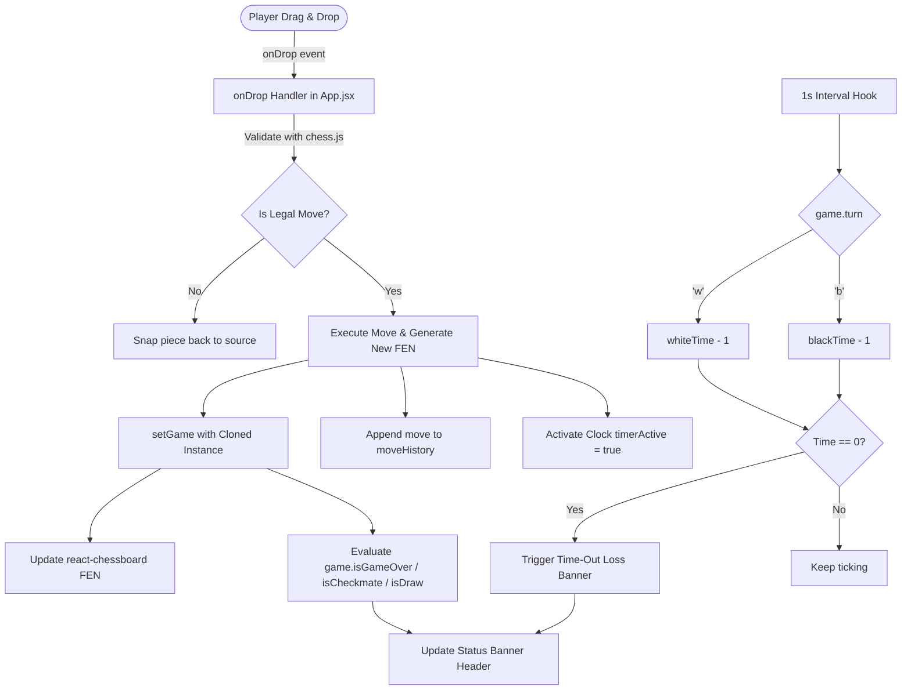

# ♟️ Interactive React Chess Application

A modern, responsive, and feature-rich chess web application crafted with **React 19**, **Vite**, **Tailwind CSS v4**, **Chess.js**, and **react-chessboard**. Designed with a sleek Chess.com-inspired dark UI, it features full chess rule enforcement, dynamic independent clocks with selectable time controls, algebraic move history tracking, and automatic game state resolution.

---

## 📑 Table of Contents

- [Overview](#-overview)
- [Key Features](#-key-features)
- [System Architecture & State Flow](#-system-architecture--state-flow)
- [Tech Stack & Libraries](#-tech-stack--libraries)
- [Project Structure](#-project-structure)
- [Getting Started](#-getting-started)
  - [Prerequisites](#prerequisites)
  - [Installation](#installation)
  - [Development Server](#development-server)
  - [Building for Production](#building-for-production)
- [Available Scripts](#-available-scripts)
- [Game Engine & Implementation Details](#-game-engine--implementation-details)
  - [Move Validation & Immutability](#move-validation--immutability)
  - [Clock Management & Interval Hook](#clock-management--interval-hook)
  - [Status & Outcome Resolution](#status--outcome-resolution)
- [Configuration & Styling](#-configuration--styling)
- [Roadmap & Planned Features](#-roadmap--planned-features)
- [Contributing](#-contributing)
- [License](#-license)

---

## 🌟 Overview

This project provides a clean, web-based two-player chess experience running entirely client-side. Built on the newest React 19 and Tailwind CSS v4 primitives, the interface mirrors competitive digital chess platforms with dedicated player cards (Hikaru vs. Magnus), live chess clocks that switch automatically upon each move, and an interactive move journal logging standard algebraic notation (SAN).

---

## ✨ Key Features

- **Drag-and-Drop Chessboard Interface**:
  - Smooth piece dragging and snapping using [`react-chessboard`](https://github.com/Clariity/react-chessboard) (v5 API).
  - Custom square colors matching the classic wood/green tournament styling (`#779556` dark squares and `#ebecd0` light squares).
  - Smooth piece animations (200ms transition duration).
  - Touch-friendly layout with disabled native pull gestures (`touch-none`).

- **Rigorous Chess Rule Engine**:
  - Full FEN state validation powered by [`chess.js`](https://github.com/jhlywa/chess.js) (`v1.4.0`).
  - Automatic validation of all legal moves, checks, double checks, discovered checks, checkmate, stalemate, and draws (threefold repetition, insufficient material, 50-move rule).
  - Standard pawn promotion handling (auto-promotes to Queen upon reaching the 8th rank).
  - Illegal moves immediately bounce back to their source square without mutating game state.

- **Dynamic Turn-Aware Clocks & Time Controls**:
  - Dual independent clocks for White and Black.
  - Active clock ticks only when it is that player's turn (`game.turn()`).
  - Clock starts automatically upon the first executed move.
  - Quick format selection:
    - ⚡ **Blitz 3m** (180 seconds per player)
    - ⚡ **Blitz 5m** (300 seconds per player)
    - ⏱️ **Rapid 10m** (600 seconds per player, default)
  - Urgent countdown indicator: Clock displays warning red highlight when time drops below 60 seconds.
  - Automatic time-out forfeiture detection (`White wins on time` or `Black wins on time`).

- **Live Move Notation & History**:
  - Records full game history using Standard Algebraic Notation (SAN).
  - Two-column numbered ledger (Turn number, White move, Black move).
  - Alternating row styling with auto-scroll for extended games.

- **Real-Time Game Banner**:
  - Header panel dynamically announces turn (`White to move` / `Black to move`).
  - Automatically flags end-game conditions: Checkmate, Draw, or Win on Time.

- **Responsive Dark Theme**:
  - Mobile-first layout designed with Tailwind CSS v4.
  - Stacks vertically on mobile/tablet viewports and organizes into a two-column desktop command center.

---

## 🏗️ System Architecture & State Flow

The following diagram illustrates the interaction between React state, `chess.js`, the timer effect, and the board UI:



---

## 💻 Tech Stack & Libraries

| Technology | Version | Purpose |
| :--- | :--- | :--- |
| **[React](https://react.dev/)** | `^19.2.8` | Declarative UI framework & state hooks |
| **[React DOM](https://react.dev/)** | `^19.2.8` | DOM rendering layer |
| **[Vite](https://vite.dev/)** | `^8.3.0` | Ultra-fast build tool and local dev server |
| **[chess.js](https://github.com/jhlywa/chess.js)** | `^1.4.0` | Chess logic, legal move generation, and rule verification |
| **[react-chessboard](https://github.com/Clariity/react-chessboard)** | `^5.12.1` | Configurable chessboard UI component supporting drag-and-drop |
| **[Tailwind CSS](https://tailwindcss.com/)** | `^4.3.3` | Utility-first styling engine |
| **[@tailwindcss/vite](https://tailwindcss.com/docs)** | `^4.3.5` | Native Vite integration plugin for Tailwind v4 |
| **[ESLint](https://eslint.org/)** | `^10.10.0` | Code quality and linting |

---

## 📂 Project Structure

```text
chess-app/
├── public/                       # Static public assets
│   ├── favicon.svg               # Web favicon
│   └── icons.svg                 # SVG sprite sheet
├── src/
│   ├── assets/                   # Static imagery & logos
│   │   ├── hero.png
│   │   ├── react.svg
│   │   └── vite.svg
│   ├── App.css                   # Component-specific stylesheet
│   ├── App.jsx                   # Main chess app component, state, & controllers
│   ├── index.css                 # Global CSS entrypoint (@import "tailwindcss")
│   └── main.jsx                  # React DOM root bootstrapping
├── eslint.config.js              # ESLint flat configuration file
├── index.html                    # Single-page HTML shell
├── package.json                  # Dependencies, metadata, and script definitions
├── package-lock.json             # Exact dependency lockfile
├── vite.config.js                # Vite build configuration (React & Tailwind plugins)
└── README.md                     # Comprehensive project documentation
```

---

## 🚀 Getting Started

Follow these steps to set up and run the application locally on your machine.

### Prerequisites

Ensure you have the following installed:
- **Node.js**: `v18.0.0` or higher (Node 20+ LTS recommended)
- **Package Manager**: `npm` (bundled with Node), `pnpm`, or `yarn`

Verify your Node version:
```bash
node -v
npm -v
```

### Installation

1. Clone or download the repository to your local directory:
   ```bash
   git clone <repository-url>
   cd chess-app
   ```

2. Install all required dependencies:
   ```bash
   npm install
   ```

### Development Server

Start the local development server with Vite:
```bash
npm run dev
```

Once the server initializes, navigate to:
```text
http://localhost:5173
```
Any edits saved to files inside `src/` will reflect immediately via Hot Module Replacement (HMR).

### Building for Production

Compile and bundle the production-ready assets:
```bash
npm run build
```
This generates optimized static files in the `dist/` directory.

To preview the production bundle locally:
```bash
npm run preview
```

---

## 📜 Available Scripts

| Command | Action |
| :--- | :--- |
| `npm run dev` | Starts the Vite development server with hot-reloading |
| `npm run build` | Compiles production assets into the `dist/` directory |
| `npm run preview` | Spins up a local static server to test the production build |
| `npm run lint` | Runs ESLint across all `.js` and `.jsx` files |

---

## 🧠 Game Engine & Implementation Details

### Move Validation & Immutability

Because `chess.js` objects maintain mutable internal states, React state updates must produce a fresh instance to ensure correct re-renders:

```javascript
// Clones the game by replaying previous SAN history
const gameCopy = new Chess();
game.history().forEach((m) => gameCopy.move(m));

// Attempts move execution; throws an error if illegal
gameCopy.move({
  from: sourceSquare,
  to: targetSquare,
  promotion: "q",
});

// Updates state upon success
setGame(gameCopy);
setMoveHistory(gameCopy.history());
```

If an illegal move is attempted, `gameCopy.move()` throws, the `catch` block intercepts it, and `onDrop` returns `false`, signaling `react-chessboard` to snap the piece back.

### Clock Management & Interval Hook

The chess timer is powered by an optimized `useEffect` hook that listens to the turn of the board:

```javascript
useEffect(() => {
  if (!timerActive || gameOver) return;

  const interval = setInterval(() => {
    if (game.turn() === "w") {
      setWhiteTime((prev) => Math.max(0, prev - 1));
    } else {
      setBlackTime((prev) => Math.max(0, prev - 1));
    }
  }, 1000);

  return () => clearInterval(interval);
}, [timerActive, gameOver, game]);
```

- When `timerActive` is `false` (before the first move), the clock is paused.
- Once a player moves, the timer initiates and switches active countdowns on each turn.
- The interval automatically cleans up when the game concludes or resets.

### Status & Outcome Resolution

The `getStatus()` helper method evaluates states in order of priority:
1. **Time Expired**: Checks if White or Black has hit `0:00`.
2. **Checkmate**: Checks if `game.isCheckmate()` is true and identifies the winner based on whose turn was mated.
3. **Draw**: Evaluates `game.isDraw()` (stalemate, threefold repetition, insufficient material).
4. **Active Turn**: Renders `${White | Black} to move`.

---

## 🎨 Configuration & Styling

- **Tailwind CSS v4**: Utilizes the modern CSS-first configuration via `@tailwindcss/vite` in `vite.config.js` and `@import "tailwindcss";` in `src/index.css`.
- **Custom Color Palette**:
  - Dark Board Square: `#779556` (Olive Green)
  - Light Board Square: `#ebecd0` (Cream)
  - App Background: `#312e2b` (Warm Charcoal)
  - Panel Background: `#262421` (Deep Charcoal)
  - Header & Move History Accent: `#1e1c1a`
  - Action Button: `#81b64c` with `#a3d160` hover

---

## 🗺️ Roadmap & Planned Features

- [ ] **Stockfish AI Engine**: Integrate Stockfish via Web Worker for single-player offline play.
- [ ] **Pawn Promotion Modal**: Allow users to explicitly choose between Queen, Knight, Rook, or Bishop.
- [ ] **Sound Effects**: Audio cues for move execution, captures, checks, castling, and game completion.
- [ ] **Board Orientation Toggle**: Ability to flip the board to play from Black's perspective.
- [ ] **PGN / FEN Import & Export**: Download completed match PGNs or load positions via FEN strings.
- [ ] **Online Real-Time Multiplayer**: WebSocket or Firebase room-based matchmaking.

---

## 🤝 Contributing

Contributions are welcome! If you'd like to improve the app:

1. Fork the repository.
2. Create your feature branch:
   ```bash
   git checkout -b feature/awesome-feature
   ```
3. Commit your changes:
   ```bash
   git commit -m "Add awesome feature"
   ```
4. Push to your branch:
   ```bash
   git push origin feature/awesome-feature
   ```
5. Open a Pull Request.

---

## 📄 License

This project is licensed under the [MIT License](LICENSE).
